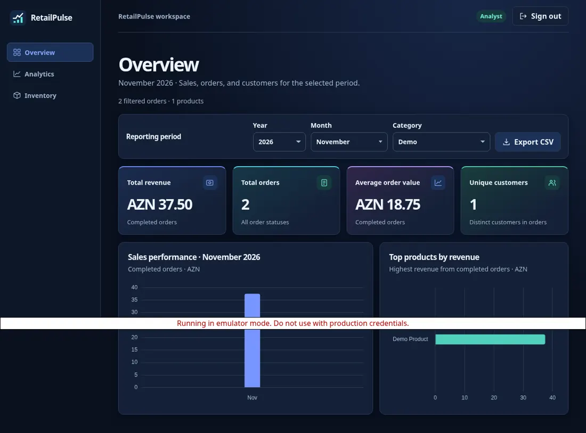

# RetailPulse Cloud Analytics

RetailPulse is a university portfolio project for retail sales analysis and inventory operations. It presents Firestore demo data in a responsive workspace with role-based access.

**Live demo** [RetailPulse on Firebase Hosting](https://retailpulse-cloud-analytics.web.app). An existing RetailPulse account with an active role is required.

## Dashboard preview

Captured from the application with isolated emulator test data.

## Features

- Sales KPIs, monthly revenue, and top products from stored orders, with year, month, and category filters.
- A searchable product catalog with stock status and independent stock adjustments.
- Order entry with Firestore validation and an atomic stock deduction.
- CSV export of the same orders used by the analytics filters.

Revenue and average order value use completed orders. Order count and distinct customer count use all matching orders. The inventory table shows current stock independently of the historical sales period and follows the category filter.

| Role | Products | Orders and analytics | Customer directory | Create orders | Adjust stock | CSV button |
| --- | --- | --- | --- | --- | --- | --- |
| Admin | Read | Read | Read | Yes | Yes | Yes |
| Sales | Read | Read | Read | Yes | — | — |
| Inventory | Read | — | — | — | Yes | — |
| Analyst | Read | Read | — | — | — | Yes |

The matrix describes workspace access and the tested Firestore rules in this repository. All four active roles can read products. Only Admin and Sales can read the customer directory. Admin, Sales, and Analyst can read orders. Analysts can see customer IDs stored in orders. Accounts without a recognized active profile cannot read these collections under the tested rules.

## Architecture

The Vite frontend uses HTML, CSS, JavaScript, and Chart.js. Firebase Authentication handles email/password sign-in. The app watches the signed-in user's profile at `users/{uid}` and loads the permitted Firestore collections. Firestore Rules enforce backend access. Inventory changes and order creation use Firestore transactions. Firebase Hosting serves the static build. Python scripts and CSV files supplied the original demo dataset.

New orders reference existing product and customer documents, use a server timestamp and UTC order date, and commit with the exact stock deduction. Firestore validates the quantity, current unit price, and rounded total. Existing historical orders require no migration. This rule set also preserves stock increases and decreases for active admins and inventory users.

## Local setup

1. Install Node.js 24.12 or newer and run `npm ci`.
2. Create an ignored `.env.local` from your Firebase web app configuration. Set `VITE_FIREBASE_API_KEY`, `VITE_FIREBASE_AUTH_DOMAIN`, `VITE_FIREBASE_PROJECT_ID`, `VITE_FIREBASE_STORAGE_BUCKET`, `VITE_FIREBASE_MESSAGING_SENDER_ID`, and `VITE_FIREBASE_APP_ID`. Use web app values only.
3. Run `npm run dev` to open the app or `npm run build` to build it.
4. With the Firebase CLI and Java 21+ on your PATH, run `npm test`. Firestore tests use the isolated `demo-retailpulse` project.

Firebase profile documents need an approved lowercase `role` and Boolean `active: true`. The production Admin SDK key belongs outside frontend assets and Git.

## Deployment and current status

The hosted demo is separate from the code on GitHub. A commit or passing emulator tests does not publish Hosting or Firestore rules. The current release includes a dark analytics workspace, product and order search, and matching RetailPulse browser icons. See [MANUAL_FINAL_STEPS.md](MANUAL_FINAL_STEPS.md) for publication and verification.

The previous rules baseline permitted any authenticated account to read products, customers, and orders. The revised rules apply the role matrix above while preserving historical reads for authorized roles and stock-only adjustments. The revision was tested in the emulator. Confirm the active production rules in Firebase before relying on those restrictions in the live demo.

Order dates use UTC, while Firestore supplies the authoritative creation timestamp. A request that crosses UTC midnight or comes from a clock with the wrong UTC date may be rejected. The transaction is atomic in that case. Revenue excludes completed records with missing or invalid numeric amounts. Order count includes all matching statuses and customer count uses distinct nonempty identifiers.

## CV summary

Built and hosted a role-based retail analytics dashboard using Vite, Firebase, Firestore, and Chart.js. Implemented sales KPIs and CSV reporting, secured inventory workflows, and tested atomic order processing with the Firestore emulator.
