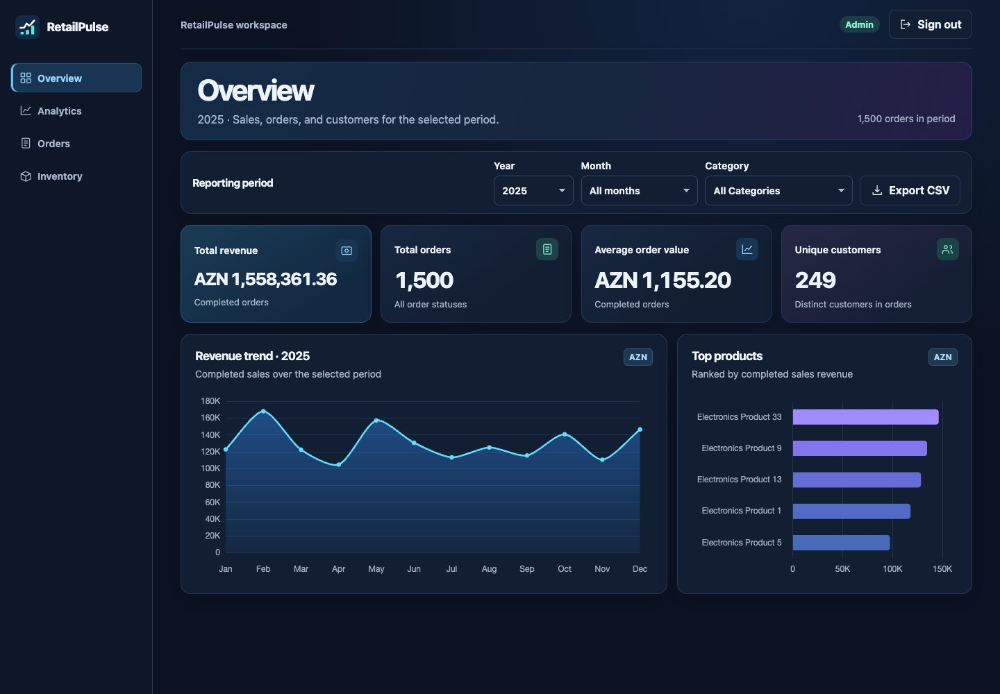

# RetailPulse Cloud Analytics

RetailPulse is a university portfolio project for retail sales analysis and inventory operations. It presents Firestore demo data in a dark-first, responsive business intelligence workspace with role-based access.

**Live demo** [RetailPulse on Firebase Hosting](https://retailpulse-cloud-analytics.web.app). An existing RetailPulse account with an active role is required.

## Problem and solution

A retail team needs to answer two questions quickly: what sold in a given period, and how much stock is available now? RetailPulse connects sales reporting and inventory operations in one workspace. Staff filter orders and export the result, while authorized users make stock adjustments or record a sale.

## Stack

- **Frontend:** HTML, CSS, JavaScript, Vite, and Chart.js
- **Cloud:** Firebase Authentication, Cloud Firestore, Security Rules, and Firebase Hosting
- **Verification:** Node.js test runner, Firebase Local Emulator Suite, and Chrome workflow checks
- **Demo data:** CSV fixtures and Python generation and import scripts

## Screenshots

The desktop overview and mobile inventory were captured in Chrome with the repository's demo data loaded into local Firebase emulators.

[View the mobile inventory screenshot](docs/screenshots/mobile-inventory.jpg)

## Features

- Sales KPIs, monthly revenue, and top products from stored orders, with year, month, and category filters.
- A searchable product catalog with stock status and independent stock adjustments.
- Order entry with Firestore validation and an atomic stock deduction.
- CSV export of the same orders used by the analytics filters.

## Analytics methodology

| KPI | Definition |
| --- | --- |
| Total revenue | Sum of valid nonnegative totals for completed orders in the selection, in AZN |
| Total orders | Count of matching orders across all statuses |
| Average order value | Completed-order revenue divided by the count of completed orders with valid amounts |
| Unique customers | Distinct nonempty customer IDs across matching orders |

Year and month filters use the UTC order date. The category filter joins each order to its product ID. The revenue chart groups completed orders by month, with a zero for a month without completed sales. The product chart ranks products by completed revenue. CSV exports the same filtered order rows and escapes spreadsheet formula prefixes. Inventory shows current stock and follows the category filter independently of the historical dates.

## Role-based access

| Role | Products | Orders and analytics | Customer directory | Create orders | Adjust stock | CSV button |
| --- | --- | --- | --- | --- | --- | --- |
| Admin | Read | Read | Read | Yes | Yes | Yes |
| Sales | Read | Read | Read | Yes | — | — |
| Inventory | Read | — | — | — | Yes | — |
| Analyst | Read | Read | — | — | — | Yes |

The table describes the workspace and the proposed direct Firestore read policy. The live rules currently allow any authenticated account to read products, customers, and orders directly. Role-aware reads in this repository are pending approval.

## Architecture

The Vite frontend uses HTML, CSS, JavaScript, and Chart.js. Firebase Authentication handles email/password sign-in. The app watches the signed-in user's profile at `users/{uid}` and loads the permitted Firestore collections. Firestore Rules enforce backend access. Inventory changes and order creation use Firestore transactions. Firebase Hosting serves the static build. Python scripts and CSV files supplied the original demo dataset.

| Firestore path | Purpose |
| --- | --- |
| `users/{uid}` | The user's role and active status |
| `products/{productDocId}` | Product ID, category, price, stock, and latest order reference |
| `customers/{customerDocId}` | Customer ID and directory details |
| `orders/{orderId}` | Product and customer references, UTC date, server timestamp, quantity, price, total, and status |

New orders reference existing product and customer documents, use a server timestamp and UTC order date, and commit with the exact stock deduction. Firestore validates the quantity, current unit price, and rounded total. Existing historical orders require no migration. This rule set also preserves stock increases and decreases for active admins and inventory users.

## Local setup

1. Install Node.js 24.12 or newer and run `npm ci`.
2. Create an ignored `.env.local` from your Firebase web app configuration. Set `VITE_FIREBASE_API_KEY`, `VITE_FIREBASE_AUTH_DOMAIN`, `VITE_FIREBASE_PROJECT_ID`, `VITE_FIREBASE_STORAGE_BUCKET`, `VITE_FIREBASE_MESSAGING_SENDER_ID`, and `VITE_FIREBASE_APP_ID`. Use web app values only.
3. Run `npm run dev` to open the app or `npm run build` to build it.
4. With the Firebase CLI and Java 21+ on your PATH, run `npm test`. Firestore tests use the isolated `demo-retailpulse` project.

Firebase profile documents need an approved lowercase `role` and Boolean `active: true`. The production Admin SDK key belongs outside frontend assets and Git. The legacy Python import script replaces documents by ID and is unnecessary for routine use of the hosted demo.

## Security and deployment

Firebase Authentication establishes identity. The app listens to the signed-in user's own profile and opens data listeners for the collections used by that role. The proposed rules enforce the same read matrix at the database. Only active Admin and Sales users can write new orders, and active Admin and Inventory users can adjust stock. Order creation validates the matching stock write and rejects standalone deductions from Sales.

A Hosting release publishes the static `dist` build. Firestore Rules are published separately with explicit owner approval. Test transactions run against local emulators and synthetic documents.

## Status

The hosted dashboard, independent stock adjustments, and atomic order creation are live. The active production ruleset is `1b8d2d75-ec37-41c4-bcde-5828d462e113`. The pending rules change narrows collection reads to the workspace roles above and preserves the live order and stock write permissions. See [Manual final steps](MANUAL_FINAL_STEPS.md).

Order dates use UTC. A submission that crosses midnight UTC between the client timestamp and the server commit can be rejected safely and retried with the new date. Failed orders leave inventory unchanged.

## Limitations and possible next steps

- The hosted dashboard requires an existing account. Signed-in browser workflows were verified with emulator accounts. Production authentication was outside this verification.
- Reporting loads the allowed collections in the browser. Larger datasets could benefit from aggregate queries and pagination.
- The demo models one product per order. Multi-line orders and historical inventory snapshots are potential extensions.

## Portfolio materials

- [University presentation outline and speaker notes](docs/PORTFOLIO_PRESENTATION.md)
- [Release verification and security status](docs/FINAL_RELEASE_REPORT.md)

## CV summary

Built and hosted a role-based retail analytics dashboard using Vite, Firebase, Firestore, and Chart.js. Implemented sales KPIs and CSV reporting, secured inventory workflows, and tested atomic order processing with the Firestore emulator.
